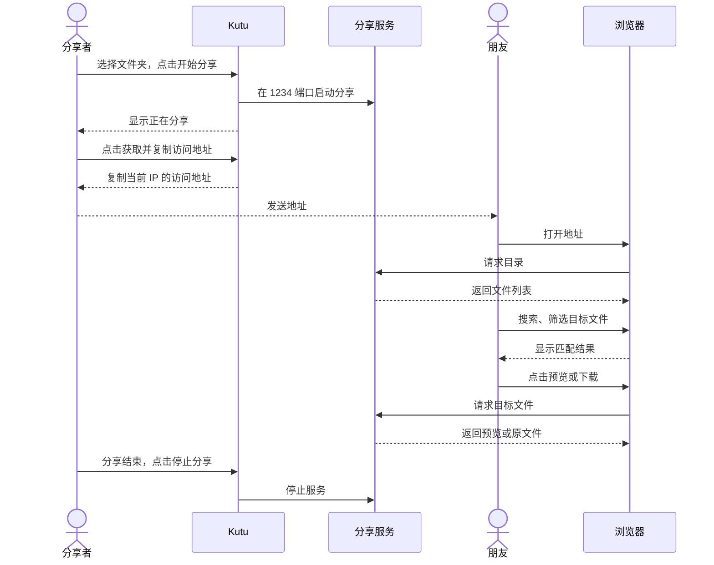
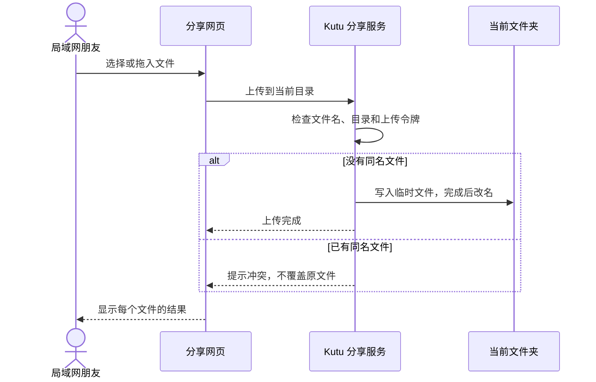
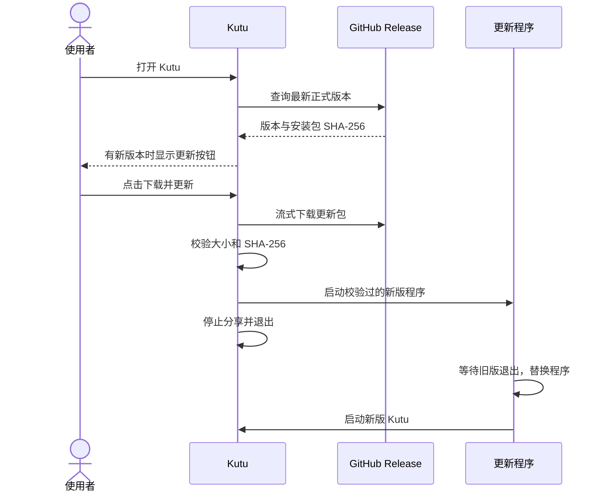
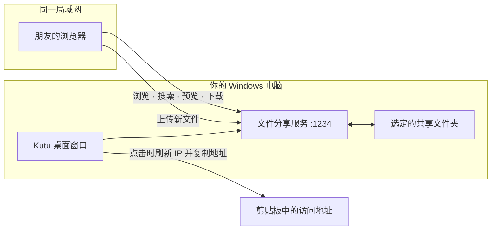

<p align="center"></p>

# Kutu

Kutu（酷 tool）是面向 Windows 的原生桌面小工具。当前第一个功能是**局域网文件分享**：选择文件夹，点击开始，再把复制的访问地址发给朋友。朋友用浏览器即可浏览、下载和上传文件。后续功能会按实际需求逐步加入。

> 当前处于首版开发与验证阶段。尚未发布可供普通用户下载的安装包。

## 使用场景

### 用例一：分享文件并让朋友找到它



### 用例二：朋友上传文件



## 使用方法

1. 打开 `Kutu.exe`，点击“选择文件夹”。
2. 点击“开始分享”。如果 Windows 防火墙弹出提示，请允许**专用网络**访问。
3. 点击“获取并复制访问地址”，把地址发给连接同一 Wi-Fi 或局域网的朋友。朋友打开网页后，可以点击“选择文件上传”，或把文件拖进上传区域。
4. 分享结束后点击“停止分享”，或关闭程序。

电脑换了 Wi-Fi 或 IP 地址后，再点一次“获取并复制访问地址”。如果列表中出现多个网卡地址，可选当前使用的网卡，再复制。

访问地址形如 `http://192.168.1.23:1234/`；IP 会变化，端口固定为 `1234`。

网页会显示文件修改时间和大小，可按名称、类型、时间范围筛选，或按名称、时间和大小排序。首次打开默认显示今天修改的文件，每页 10 项，并按修改时间倒序排列。浏览器会在本地记住上次选择的类型、时间、排序、每页条数和自定义日期；同一访问地址下再次打开时沿用这些选项。点击“清除筛选”会显示全部时间并保存该选择。上传入口位于页面右上角，点击后展开；点击面板外或按 Esc 可收起。

常见图片会在列表中显示缩略图。点击缩略图或右侧眼睛图标可放大预览；点击文件名或右侧下载图标可下载原文件。超过 20 MB 的图片和浏览器不支持直接预览的格式仍显示类型图标。

浏览器标签页使用 Kutu 图标。网页顶部保持简洁，让文件筛选和列表优先进入视线。

## 更新 Kutu

窗口底部会在启动时检查 [GitHub Releases](https://github.com/KelvinFanXian/Kutu/releases)；也可点击“检查更新”。有新版本时，点击“下载并更新”，Kutu 会校验下载文件，然后重启完成替换。更新重启期间，正在进行的文件分享会停止，需重新选择文件夹并启动。检查只在启动或点击按钮时发生，不会常驻后台轮询。



目前尚未发布 GitHub Release，因此检查会提示没有新版本。发布流程见[发布说明](docs/RELEASING.md)。

## 工作方式



## 安全边界

- 访问者可以浏览、下载和上传到当前网页所显示的文件夹；上传不会覆盖同名文件，也不能删除或修改已有文件。
- 单个上传文件上限为 10 GB。上传中断时，临时文件会清理。
- Git 元数据目录（`.git`、`.hg`、`.svn`）不显示，也不能通过构造地址访问。
- 只在程序运行并启动分享时开放；固定监听 TCP `1234` 端口。
- 首版不设密码。同一网络中的人可能上传文件；请仅在可信任的局域网中使用，不要转发端口到互联网。
- 目录中的符号链接和 Windows junction 不会被分享，避免跳出选定文件夹。

## 开发与构建

要求 Windows 10/11 和 [.NET 10 SDK](https://dotnet.microsoft.com/en-us/download/dotnet/10.0)。

```powershell
dotnet build .\Kutu.csproj
dotnet run --project .\Kutu.csproj
dotnet run --project .\tests\Kutu.IntegrationTests\Kutu.IntegrationTests.csproj
node .\tests\web-filter.test.js
```

生成给朋友使用的自包含单文件程序：

```powershell
.\scripts\publish.ps1
```

输出位于 `publish\win-x64\Kutu.exe`。自包含程序无需对方安装 .NET Runtime。首次运行 Windows 可能显示未签名程序提示；正式分发前可再考虑代码签名。

## 项目结构

```text
App.xaml / MainWindow.xaml    Windows 原生桌面界面
Features/FileShare/           第一个功能：局域网文件分享及网页资源
Assets/                       黑色盒子 Logo 源图、应用图片与 Windows 图标
Features/Updates/             GitHub Release 检查、下载校验与更新替换
scripts/publish.ps1           发布脚本
docs/                         产品要求、架构和验证记录
PLAN.md                       开发计划与进度
```

## 文档

- [产品要求](docs/REQUIREMENTS.md)
- [架构与安全设计](docs/ARCHITECTURE.md)
- [验证记录](docs/TEST_REPORT.md)
- [实施计划](PLAN.md)
- [Agent 协作规则](AGENTS.md)
