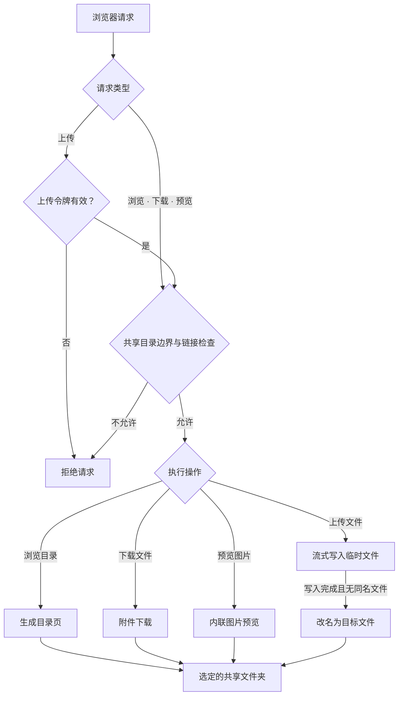

# Kutu 架构与安全设计

当前仅实现文件分享功能。`Features/FileShare` 包含该功能的服务与网卡地址检测，WPF 主窗口承载首版引导流程。后续功能进入独立的 `Features/<FeatureName>` 目录，再按真实需要演进主窗口导航。

## 组成

- WPF 窗口负责三步引导、文件夹选择、状态反馈和剪贴板。
- `NetworkAddresses` 在按钮点击时枚举当前已连接网卡的 IPv4 地址，并优先显示带网关的私有网络地址。
- `ShareServer` 使用 ASP.NET Core Kestrel 监听本机端口，提供目录列表和文件下载。

## 请求处理

浏览和下载只接受 GET 和 HEAD；上传使用 POST `/_kutu/upload`。解析相对路径后，逐段检查路径边界，并拒绝路径中的 reparse point。目录列表对显示文本做 HTML 转义，对链接路径做 URL 编码；文件以附件形式下载，设置 `nosniff` 和禁止缓存响应头。

图片预览使用 GET/HEAD `/_kutu/preview?path=...`，与下载共用目录边界检查。仅常见浏览器可显示的 JPG、PNG、GIF、WebP、BMP 且不超过 20 MB 的文件以内联图像返回。SVG 等格式继续使用类型图标，避免浏览器执行其中的活动内容。列表中的图片缩略图使用延迟加载；点击缩略图或眼睛图标打开预览，下载图标仍请求附件下载地址。

网页上传把文件以原始请求体流式写入当前目录中的随机临时文件，完成后原子改名。已有同名文件返回 409，不覆盖。单文件上限 10 GB。页面内的随机令牌随分享服务启动生成，请求须通过自定义头携带；它用于防止其他网页跨站诱导上传，不是用户身份认证。页面脚本使用 CSP nonce。Git 元数据目录（`.git`、`.hg`、`.svn`）以及上传临时文件被隐藏并拒绝直接访问。

目录页由 `DirectoryPageRenderer` 生成，样式和脚本作为嵌入资源打包进单文件程序。每行携带类型、修改时间和文件大小元数据；浏览器在当前目录内完成搜索、筛选和排序，不向服务端重复请求。文件夹保留在时间筛选结果中，便于继续进入子目录。

筛选选项保存在浏览器 `localStorage` 中，首次访问默认“今天”和每页 10 项，之后加载上次选择。保存范围为当前网页来源（协议、地址和端口）；若本机 IP 变化导致访问地址变化，新地址会重新使用首次默认值。名称搜索不保存。

浏览器标签使用 `/favicon.ico`，目录页标题使用 `/_kutu/logo.png`。两份品牌资源随程序嵌入，服务端以对应图片类型返回；目录页 CSP 允许加载同源图片。

## 威胁模型

首版的目标是避免误操作和目录越界，不提供访问者身份认证。只要同一网络中的设备能够连接该端口，就可能读取所选目录中的文件并上传新文件。共享目录含敏感资料时，不应启动分享。Windows 防火墙的专用网络授权由系统提示，应用不会自动修改防火墙规则。
