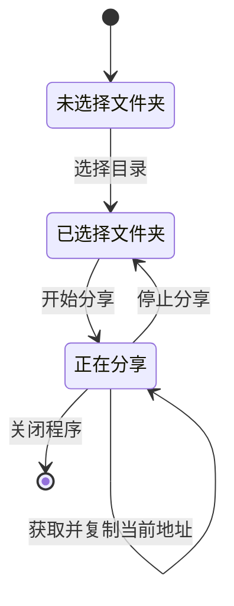

# Kutu 产品要求

Kutu 是持续扩展的 Windows 原生工具项目。本文件只定义第一个功能“局域网文件分享”的首版要求；新增工具应单独记录要求和验收条件。

## 目标用户

Windows 普通用户，能选择文件夹和复制链接，但不需要理解 IP、端口或命令行。

## 首版流程

1. 清楚地说明选什么、分享何时开始和结束。
2. 使用系统原生文件夹选择器指定共享目录。
3. 启动 HTTP 文件分享服务，显示运行状态和可理解的错误。
4. 点击“获取并复制访问地址”时重新枚举当前 IPv4 地址，生成 `http://IP:端口/` 并写入剪贴板。
5. 多网卡时允许手动选择；停止或关闭程序后终止分享。
6. 访问者用浏览器浏览目录、返回上一级、下载文件，并上传到当前目录；可选择多个文件或拖放上传，显示单文件进度与结果。
7. 文件列表优先显示，包含名称、修改时间和大小；可按名称搜索、按类型与修改时间筛选，并按名称、时间或大小排序。默认按最近修改时间倒序，文件夹置顶。上传入口默认收起。
8. 列表分页，首次打开默认每页 10 项，可切换 10、25、50、100 项；修改时间首次默认“今天”，切换筛选或排序后回到第一页。浏览器本地保存筛选、排序、分页条数及自定义日期，后续访问优先使用上次设置。
9. 常见图片在列表中显示缩略图，可放大预览；文件行右侧提供预览或下载操作图标。预览不改变原文件的附件下载方式。
10. 浏览器标签和文件列表标题显示 Kutu Logo，方便识别分享页面。

## 验收条件

- 选定目录之外的文件不可通过构造 URL 读取。
- 符号链接和 junction 不可用于越出分享目录。
- 路径和文件名中包含中文、空格、HTML 特殊字符时，列表仍能正确显示和访问。
- IP 变化后再次点击复制，得到新的地址。
- 端口占用、目录不存在和无可用网卡时，界面给出提示。
- 上传不得覆盖同名文件；无效文件名、越界目录、符号链接目标、无令牌请求和超限文件须被拒绝。
- 上传中断或失败不应留下可见的半成品文件。
- 时间筛选提供今天、最近 7 天、最近 30 天和自定义起止日期；筛选只作用于当前文件夹的文件，文件夹保持可见以便继续导航。

## 当前边界

不提供删除、编辑已有文件、用户认证、互联网访问、开机自启和后台常驻。首版无密码，适用于可信任的局域网。
